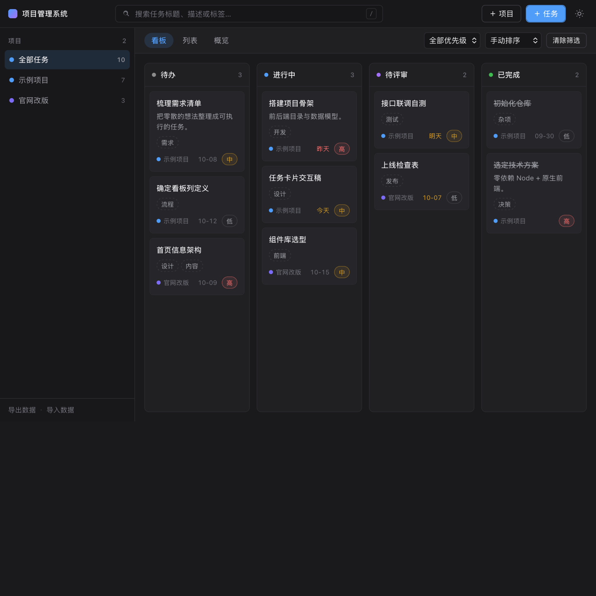
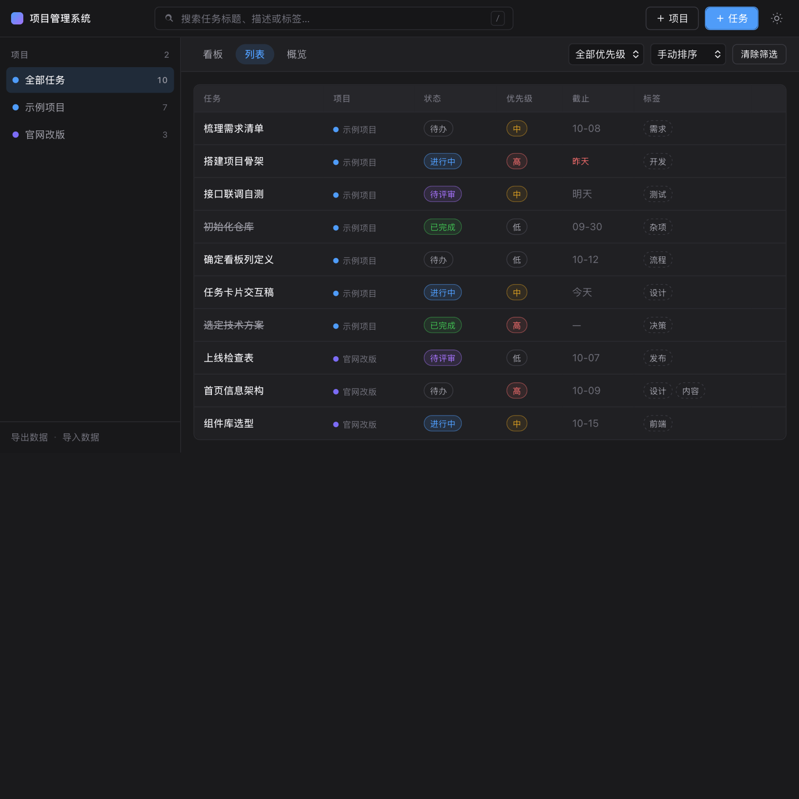
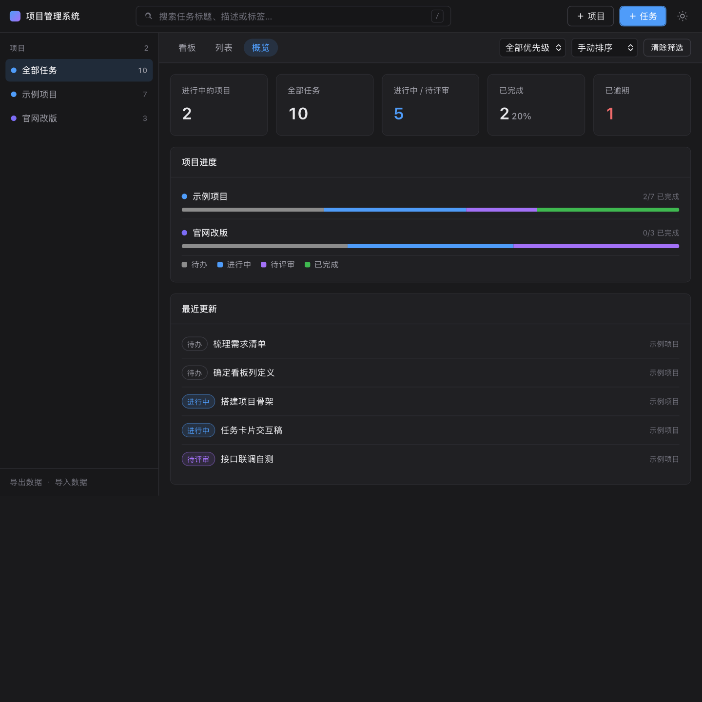

# 项目管理系统（VSCode 风格）

[](https://github.com/zhengxiyu880-ui/vscode-pm/actions/workflows/ci.yml)
[](package.json)
[](package.json)
[](LICENSE)

> 一个**零依赖**的本地项目管理工具：项目、任务、看板一体化。
> 界面走 VSCode 的克制风格 —— 深色底 + 单一强调色、1px 细边框、无冗余装饰。
>
> **`git clone` → `npm start`，没有 `npm install`，没有构建步骤。**

English: a zero-dependency, self-hosted project & kanban board for one person.
Node built-ins only — no Express, no database driver, no bundler, no `node_modules`.
Clone it and run it. Data lives in one JSON file you can back up by copying it.

---

## 为什么做这个

时间管理工具的通病是**你要先花时间管理工具**：注册账号、同步、订阅、等它加载。
而我只是想在本地有一块看板，随手记任务，不想联网、不想注册、不想被通知打扰。

所以这个项目的约束是刻意定的：

| 约束 | 原因 |
| --- | --- |
| 零依赖 | 三年后 `git clone` 还能一条命令跑起来，不会因为依赖腐烂而报废 |
| 单 JSON 文件存储 | 备份 = 复制一个文件；换机 = 带走一个文件；不需要数据库 |
| 本地优先 | 任务内容不出本机，服务默认只监听 `127.0.0.1` |
| 纯原生前端 | 没有构建产物，改完刷新就生效，方便自己改着用 |

代价是它只能单人用、没有协作与移动端 —— 对我来说正好够。

---

## 快速开始

```bash
git clone https://github.com/zhengxiyu880-ui/vscode-pm.git
cd vscode-pm
npm start            # 等价于 node server.js
```

然后打开 <http://127.0.0.1:5177>。首次启动会自动写入一份演示数据（2 个项目 / 10 个任务），可以直接改或删。

换端口：

```bash
PORT=8080 npm start
```

## 安装（不想碰命令行）

Release 页面提供打包好的版本：

| 平台 | 下载 | 用法 |
| --- | --- | --- |
| macOS 11+ | `vscode-pm-<版本>.dmg` 或 `-macos.zip` | 拖进「应用程序」→ 双击 → 浏览器自动打开界面 |
| Windows 10+ | `-windows.zip` | 解压 → 双击 `start.cmd` |

- 两个包都**需要本机装 Node.js 18+**（服务端是 Node 跑的），但**不需要 `npm install`**
- 数据落在 `~/Library/Application Support/vscode-pm/db.json`（macOS）或 `%APPDATA%\vscode-pm\db.json`（Windows）——备份就是复制这个文件
- 首次打开若提示「无法验证开发者」：右键点 app → 打开 → 再点「打开」
- 想彻底退出：右键 Dock 图标 → 退出；Windows 关掉那个命令行窗口

## 界面预览

**看板** —— 四列拖拽流转，卡片显示所属项目、截止日期与优先级



**列表** —— 表格总览，可按截止日期 / 优先级 / 创建时间排序



**概览** —— 任务统计与按项目拆分的状态分布



---

## 功能

**项目**
- 新建 / 编辑 / 删除项目，自定义标识色（8 色）
- 归档项目：从看板默认视图隐藏，需要时在侧栏「已归档」里查看
- 删除项目会级联删除其下任务（会提示数量）

**任务**
- 标题、描述、所属项目、状态、优先级（高/中/低）、截止日期、标签（最多 8 个）
- 点击卡片或列表行即可编辑；快捷键 `N` 新建任务、`/` 聚焦搜索、`Esc` 关闭弹窗、`⌘/Ctrl + Enter` 保存

**看板**
- 四列：待办 → 进行中 → 待评审 → 已完成
- 拖拽卡片跨列流转，列内可任意排序，落位即刻乐观更新并同步到服务端

**列表 / 概览**
- 列表视图：表格总览，支持手动 / 截止日期 / 优先级 / 创建时间排序
- 概览视图：任务总数、进行中、完成率、逾期数统计，以及按项目拆分的状态分布进度条

**其它**
- 全局搜索：匹配标题、描述、标签、项目名
- 按项目、优先级筛选，一键清除
- 明 / 暗主题切换（记忆在浏览器本地）
- 数据导出 / 导入 JSON，方便备份或换机

---

## 目录结构

```
vscode-pm/
├── server.js          # 零依赖后端：静态资源 + REST API + JSON 持久化
├── package.json
├── public/
│   ├── index.html     # 页面骨架
│   ├── styles.css     # 全部样式（含明暗两套 CSS 变量）
│   └── app.js         # 前端逻辑：状态 + 渲染 + 拖拽 + 弹窗
├── data/
│   └── db.json        # 数据文件（首次启动自动生成，已 gitignore）
├── docs/              # 界面预览图
├── tests/
│   ├── run.mjs        # 测试编排：每个用例独立服务 + 临时数据文件
│   ├── api.test.mjs   # 后端接口测试（31 项）
│   └── ui.test.mjs    # 前端渲染测试（24 项，用最小 DOM 桩驱动真实请求）
├── packaging/         # 打包素材
│   ├── macos/         # launcher.sh（.app 启动器）/ AppIcon.icns / make-icon.py
│   ├── windows/       # start.cmd（Windows 启动脚本）
│   └── 使用说明.txt    # 放进安装包里的说明
├── package.sh         # 打包：dmg + macOS zip + Windows zip
├── .github/workflows/
│   ├── ci.yml         # CI：Node 18/20/22/24 四版本跑语法检查 + 全部测试
│   └── release.yml    # 推 tag 时自动打包并上传到 Release
├── CONTRIBUTING.md    # 贡献约定（核心：不许加依赖）
├── CHANGELOG.md
└── LICENSE            # MIT
```

---

## 数据存储

所有数据放在 `data/db.json`，写入采用「临时文件 + rename」的原子方式，并按请求串行化，避免并发写坏文件。

```jsonc
{
  "version": 1,
  "projects": [
    { "id": "p_xxx", "name": "示例项目", "description": "", "color": "#4f9cf9",
      "archived": false, "createdAt": "…", "updatedAt": "…" }
  ],
  "tasks": [
    { "id": "t_xxx", "projectId": "p_xxx", "title": "…", "description": "",
      "status": "todo|doing|review|done", "priority": "low|medium|high",
      "due": "2026-01-31", "tags": ["需求"], "order": 0,
      "createdAt": "…", "updatedAt": "…" }
  ]
}
```

备份 = 复制这个文件，或在界面里点「导出数据」。

---

## API

| 方法 | 路径 | 说明 |
| --- | --- | --- |
| GET | `/api/state` | 拉取全部项目与任务 |
| POST | `/api/projects` | 新建项目 `{ name, description?, color?, archived? }` |
| PATCH / PUT | `/api/projects/:id` | 更新项目 |
| DELETE | `/api/projects/:id` | 删除项目（级联删除任务） |
| POST | `/api/tasks` | 新建任务 `{ title, projectId?, status?, priority?, due?, tags?, description? }` |
| PATCH / PUT | `/api/tasks/:id` | 更新任务（改状态会自动排到新列顶部） |
| DELETE | `/api/tasks/:id` | 删除任务 |
| POST | `/api/tasks/reorder` | 看板排序 `{ status, ids: [...] }`（ids 为该列从上到下的顺序） |
| GET | `/api/export` | 导出全量数据 |
| POST | `/api/import` | 导入并覆盖全量数据 |

服务端对入参做了收敛：标题/名称必填，状态与优先级非法值回退，标签去重并限长，颜色必须是合法十六进制色值，请求体上限 1MB。

---

## 测试

```bash
npm test
```

会在临时数据文件上拉起两个独立服务实例，先跑接口用例再跑前端渲染用例，跑完自动清理（不会碰你的 `data/db.json`）。

- `tests/api.test.mjs`：CRUD、字段校验、拖拽排序、导入导出与规范化、删除级联、静态资源与路径穿越防护
- `tests/ui.test.mjs`：用最小 DOM 桩加载 `public/app.js`，断言看板/列表/概览渲染、筛选与搜索、HTML 转义（XSS 防护）、拖拽落位后的状态同步

```bash
npm run check        # 仅语法检查
```

---

## 环境变量

| 变量 | 默认值 | 说明 |
| --- | --- | --- |
| `PORT` | `5177` | 服务端口 |
| `HOST` | `127.0.0.1` | 监听地址；容器/局域网访问可设为 `0.0.0.0` |
| `PM_DATA_FILE` | `data/db.json` | 数据文件路径（测试用它指向临时文件） |

> 服务默认只监听 `127.0.0.1`，即本机可访问。若要放到局域网，请自行评估数据安全。

---

## 自己打包

```bash
./package.sh            # → dist/ 下生成 .dmg、-macos.zip、-windows.zip
./package.sh --no-dmg   # 只出 zip（非 macOS 环境 / 不需要 dmg 时）
```

打包方式是**启动器**，不是 Electron：`.app` 里放一个 shell 启动脚本 + 服务端代码，
双击时找本机 node → 起本地服务 → 等端口就绪 → 打开浏览器 → 退出 app 时把服务杀掉。
好处是包只有几百 KB、不破坏「零依赖」的定位；代价是对方电脑上得有 Node。

想要「对方什么都不装、双击就能跑」的独立 `.exe` / `.dmg`，得用 Electron 或 Tauri 把 Node 运行时打进去，
体积会从几百 KB 变成 100 MB 量级 —— 现阶段刻意没做（见路线图）。

推 tag 时 GitHub Actions 会自动打包并挂到 Release（`.github/workflows/release.yml`），不用在本地跑 hdiutil。

## 路线图

按优先级排，欢迎认领（提 PR 前先开 Issue 对齐一下）：

- [ ] 数据层换成 SQLite（保留零依赖原则：用 Node 内置 `node:sqlite`），解决几万条任务时的全量读写
- [ ] 任务依赖 / 子任务（父子关系 + 阻塞提示）
- [ ] 键盘优先的快速录入（`⌘K` 命令面板，不用鼠标就能建任务）
- [ ] 日历视图（按 `due` 铺到月视图，看「这周要交什么」）
- [ ] Docker 一键部署到 NAS / 小主机（`HOST=0.0.0.0` + 挂载 data 目录）
- [ ] 可选 Electron / Tauri 打包，做成不依赖本机 Node 的独立安装包
- [ ] 可选的多用户（加一层密码 + 每人一个 data 文件，仍不引入数据库）

## 设计说明

- **简约但不简陋**：只用一套 CSS 变量控制明暗主题，圆角 6/8px，边框一律 1px，阴影只用于弹窗与卡片 hover。
- **状态驱动渲染**：前端维护单一 `state`，任何交互后整体重绘对应区域，没有引入框架也没有手写 diff。
- **乐观更新**：看板拖拽先改本地状态并立即重绘，再异步同步到服务端，失败时回滚重载。
- **安全**：所有插入 DOM 的用户内容都经过 `escapeHtml`；静态文件服务做了目录穿越校验。

---

---

[MIT](LICENSE) © 2026 Zheng Xiyu
